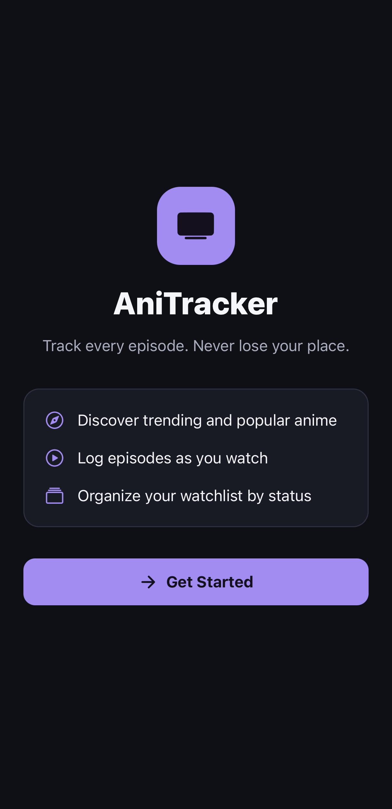

# AniTracker

AniTracker is a mobile app for tracking anime series and anime movies. Users browse a fixed catalogue of titles, add titles to their lists (Watching, Planned, Completed, On Hold, Dropped), update their episode progress and score, and see a summary of their activity.

The app is built with React Native, Expo and Expo Router. It uses mock data and local storage (AsyncStorage); there is no backend.

> Course: Project 1 (individual). Due November 24, 2026.

## Development progress

| Milestone | Status |
|---|---|
| Project setup, template removed, Zod and AsyncStorage installed | Done |
| Navigation (welcome, login, 4 tabs, details, entry form) | Done |
| Catalogue mock data and reusable components | Done |
| Mock login with Zod validation | Done |
| Add / edit / remove list entries | Done |
| AsyncStorage persistence | Done |
| My Lists screen | Done |
| Discover search and filters | Done |
| Profile settings and logout | Done |
| Home dashboard | Done |

## Features

### Welcome and Login
- Welcome screen with a Get Started button.
- Mock login validated with Zod: the email must be a valid address and the password at least 6 characters. Errors appear under each field, and wrong credentials show "Incorrect email or password".
- A successful login replaces the login screen with the tabs, so Back does not return to it.

### Home
- Personal greeting, a Browse Discover shortcut, and a Continue Watching list of titles marked Watching, with progress and a message when there are none.

### Discover
- Search bar that matches titles regardless of capitals.
- Filters button (showing how many filters are active) that opens chips for type (All / Series / Movies) and genre. Tapping the selected genre again clears it. Search and filters combine.
- Horizontal Trending and Popular rows when no search or filter is active.
- A no-results message that names the search text.

### Anime details
- Cover, title, type, genres, episodes, year, rating and synopsis.
- "Add to My List" when the title is not tracked. Otherwise the current status and progress, "Edit Entry", and "Remove from List", which asks for confirmation (Cancel / Remove).
- "Anime not found" for an unknown id.

### Entry form (add / edit)
- Status chips, episodes watched, optional score (1–10) and optional notes (max 200 characters), validated with Zod.
- Episodes cannot exceed the title's total. Choosing Completed fills in the full episode count.
- Saving shows a confirmation and returns to the previous screen.

### My Lists
- Filter chips for All and each status, each showing its count.
- Summary of titles and episodes watched.
- A different empty message for each status.
- "+1 ep" button on Watching entries that stops at the total episode count.

### Profile
- Avatar with the user's initial, name and email.
- Statistics: completed titles, movies watched, total episodes.
- Settings rows (Theme, Language, Notifications, About), each giving a dialog or confirmation when pressed.
- Log out with a confirmation, which returns to Login.

### State and storage
- List entries are kept in shared state (`EntriesContext`) and changed through `addEntry`, `updateEntry` and `removeEntry`, so every screen shows the same data.
- Entries are saved with AsyncStorage (key `anitracker:entries`) whenever they change and restored when the app starts. On the very first launch, 4 mock entries are used. After that the saved list is always used, including when it is empty.
- A loading indicator shows while entries load, and an error message shows if loading or saving fails. If loading fails, the app does not save, so stored data is never overwritten.

### Reusable components
`AnimeCard`, `EntryList`, `PrimaryButton`, `SettingsRow`, `StatusChip`, `TextField`. Each receives its data and callbacks through props.

## Screens and navigation

| Screen | Route | Purpose |
|---|---|---|
| Welcome | `/` | Entry screen with a button to log in |
| Login | `/login` | Mock login with validation |
| Home | `/(tabs)/home` | Greeting and Continue Watching |
| Discover | `/(tabs)/discover` | Search, filter and browse the catalogue |
| My Lists | `/(tabs)/lists` | The user's tracked titles by status |
| Profile | `/(tabs)/profile` | User info, statistics, settings, logout |
| Anime details | `/anime/[id]` | Information about one title, add / edit / remove |
| Entry form | `/entry/[id]` | Add or edit a list entry |

Home, Discover, My Lists and Profile are reached from the bottom tab bar, which highlights the selected tab. Logging in and logging out use `router.replace`, so Back does not cross between the logged-in and logged-out parts of the app.

```text
   ┌──────────┐      ┌──────────┐
   │ Welcome  │ ───▶ │  Login   │
   └──────────┘      └────┬─────┘
                          │ (replace)
                          ▼
   ┌────────────── Bottom tabs ───────────────┐
   │  Home    Discover    My Lists    Profile │
   └────┬────────┬───────────┬───────────┬────┘
        │        │           │           │ Logout (replace)
        └────────┴─────┬─────┘           ▼
                       ▼               Login
                ┌──────────────┐
                │ Anime details│
                └──────┬───────┘
                       ▼
                ┌──────────────┐
                │  Entry form  │  (add / edit)
                └──────────────┘
```

## Project structure

```text
src/
  app/          Expo Router routes only (screens and layouts)
  components/   Reusable UI components
  constants/    Theme, list status labels, mock user
  context/      EntriesContext: shared list state and AsyncStorage
  data/         Catalogue and starter entries (mock data)
  schemas/      Zod schemas for login and entry forms
  types/        TypeScript types
```

## Technology stack

- TypeScript
- React 19.3 and React Native 0.88
- Expo SDK 58
- Expo Router (file-based navigation)
- Zod 4 (form validation)
- @react-native-async-storage/async-storage 2.2 (local persistence)
- @expo/vector-icons (tab icons)
- ESLint with eslint-config-expo

## Installation and setup

1. Clone the repository:
   ```bash
   git clone https://github.com/razmigmazakian/anitracker.git
   cd anitracker
   ```
2. Install dependencies:
   ```bash
   npm install
   ```
3. Start the app:
   ```bash
   npx expo start
   ```
4. Scan the QR code with Expo Go on your phone.

No environment variables are needed.

Tested with: Expo Go on _[fill in: Android / iOS and device model]_.

## Mock login credentials

| Email | Password |
|---|---|
| `demo@anitracker.app` | `anime123` |

Authentication is mock only. The credentials are compared against values stored in the app; nothing connects to a real authentication service.

## Known limitations

- No backend: the catalogue is fixed mock data with 10 titles (5 series, 5 movies) and cannot be changed by the user.
- Login is mock only and does not create accounts. The login session is not remembered, so the user logs in again each time the app opens. List entries are still saved.
- Profile settings are placeholders: Theme only offers dark mode (light shows "coming soon"), the chosen language is shown but does not translate the app and is not saved after a restart, and Notifications shows a "not available" message.
- Cover images are placeholders showing the title.

## Screenshots

| Welcome | Login | Home |
|---|---|---|
|  |  |  |

| Discover | Anime details | Entry form |
|---|---|---|
|  |  |  |

| My Lists | Profile |
|---|---|
|  |  |

## AI usage statement

I used Claude (Anthropic) to plan milestones, explain concepts and error messages, review my code for problems, guide my Git workflow, and draft and update this README. All application code was written by me.

## Submission

- Final commit: _[fill in on submission]_
- Screen-flow diagram: see [Screens and navigation](#screens-and-navigation) and `screenshots/flow-diagram.png`
